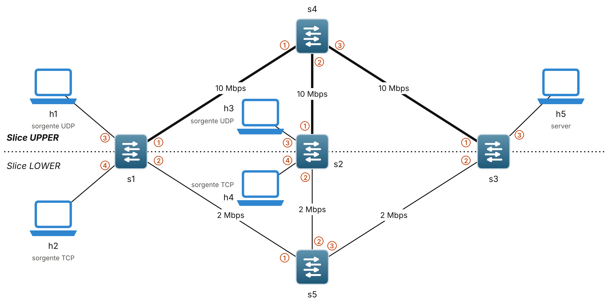

# Slicing dinamico per flusso con soglia adattiva in reti SDN

Project work per l'esame di **Network and Cloud Infrastructures**, Prof. Giorgio Ventre, A.A. 2025/2026

**Membri**
- Castrese Basile (matricola DE9000181)
- Maria Coscione (matricola DE9000085)
- Valeria De Falco (matricola DE9000078)

Relazione d'esame: [`docs/Relazione_BasileCoscioneDeFalco.pdf`](docs/Relazione_BasileCoscioneDeFalco.pdf)

---

## Il progetto

Su una coda FIFO, quando un collegamento è congestionato, il TCP rallenta e l'UDP no:
pochi flussi UDP possono lasciare quasi senza banda i flussi TCP che condividono lo
stesso percorso. Il progetto è un'applicazione **Ryu (OpenFlow 1.3)** che isola questi
flussi agendo dal control plane, senza cambiare lo scheduling.

Obiettivi:

1. **Nessun blocco automatico.** Quando il collegamento verso un server supera l'80%
   della capacità, i flussi oltre il doppio della loro parte equa vengono spostati
   temporaneamente sulla **slice LOWER** (2 Mbit/s) e riammessi sulla **slice UPPER**
   (10 Mbit/s) quando rientrano nella norma. Un falso positivo costa banda, non la
   connessione.
2. **Soglia adattiva.** La soglia `2·C/N` segue il numero N di flussi attivi.
3. **Gestione.** Con il file `policy.json` un amministratore può bloccare,
   proteggere o spostare un flusso mentre la rete è in funzione.
4. **Modularità.** Le operazioni di Monitoring, Detection, Enforcement e Policy girano in thread separati e
   comunicano tramite una coda di ordini.

## Contenuto del repository

```
.
├── topology.py              # topologia Mininet: 5 switch, 5 host, slice UPPER e LOWER
├── controller.py            # controller Ryu
├── policy.json              # regole dell'amministratore: block, allow, lower
├── experiments/             # script per la CLI di Mininet
│   ├── senza_difesa.txt
│   ├── con_difesa.txt
│   └── allow_difesa.txt
├── results/                 # output di iperf e log di Ryu, una cartella per prova
├── docs/
│   ├── Relazione_BasileCoscioneDeFalco.pdf
│   └── figures/
└── README.md
```

## Topologia



Tre switch di accesso (`s1`, `s2`, `s3`) collegati a due switch di transito: `s4` per la
slice UPPER (10 Mbit/s, 2 ms) e `s5` per la slice LOWER (2 Mbit/s, 5 ms), con code FIFO
da 100 pacchetti. Il collo di bottiglia è il link `s4 → s3`, verso il server.

| Host | IP | MAC | Ruolo | Switch di accesso |
|---|---|---|---|---|
| h1 | 10.0.0.1 | `00:00:00:00:00:01` | sorgente UDP | s1, porta 3 |
| h2 | 10.0.0.2 | `00:00:00:00:00:02` | sorgente TCP | s1, porta 4 |
| h3 | 10.0.0.3 | `00:00:00:00:00:03` | sorgente UDP | s2, porta 3 |
| h4 | 10.0.0.4 | `00:00:00:00:00:04` | sorgente TCP | s2, porta 4 |
| h5 | 10.0.0.5 | `00:00:00:00:00:05` | server | s3, porta 3 |

Sugli switch di accesso **la porta 1 va verso s4 (UPPER), la porta 2 verso s5 (LOWER)**.
La rete contiene anelli, quindi il controller non usa il flooding: installa tutte le
regole quando gli switch si collegano e risponde lui alle richieste ARP (ARP proxy).

## Ambiente di sviluppo

- VM **Ubuntu 22.04.5 LTS** con Python 3.10
- **Mininet 2.3.0** e Open vSwitch
- **Ryu 4.34** in un virtualenv (`~/ryu-venv`)
- **iperf 2**


## Esecuzione

Servono **due terminali**, entrambi nella cartella del repository: Ryu cerca
`policy.json` nella propria directory di lavoro. Avviare sempre **prima Ryu**, così gli
switch trovano il controller già in ascolto sulla porta 6653.

**Terminale 1: controller**

```bash
source ~/ryu-venv/bin/activate
ryu-manager controller.py
```

**Terminale 2: rete**

```bash
sudo mn -c
sudo python3 topology.py
```

Al prompt `mininet>`, verifica:

```
mininet> pingall              # atteso: 0% dropped (20/20 received)
mininet> h1 ping -c5 h5       # RTT circa 8 ms
```

Per chiudere: `exit` nella CLI, poi Ctrl+C su Ryu.

## Riproduzione degli esperimenti

Ogni script avvia due flussi TCP (h2 → h5, h4 → h5) per 60 s e, dal secondo 20, due
flussi UDP (h1 → h5, h3 → h5) a 6 Mbit/s ciascuno per 30 s. Dura circa 65 s e scrive i
risultati nei file `senza_*.txt`, `con_*.txt` o `allow_*.txt`.

| Scenario | `DEFENSE_ENABLED` in `controller.py` | `policy.json` | Script | Log di Ryu |
|---|---|---|---|---|
| Senza slicing dinamico | `False` | liste vuote | `experiments/senza_difesa.txt` | `ryu_senza_difesa.log` |
| Con slicing dinamico | `True` (default) | liste vuote | `experiments/con_difesa.txt` | `ryu_con_difesa.log` |
| UDP in allow | `True` | h1 → h5 e h3 → h5 in `allow` | `experiments/allow_difesa.txt` | `ryu_allow_difesa.log` |

Esempio con lo scenario *con slicing dinamico*:

```bash
# Terminale 1
ryu-manager controller.py 2>&1 | tee ryu_con_difesa.log

# Terminale 2
sudo mn -c
sudo python3 topology.py
```

```
mininet> source experiments/con_difesa.txt
mininet> sh cat con_h2_tcp.txt              # throughput TCP ogni 5 s
mininet> sh cat con_h5_udp_server.txt       # UDP ricevuto da h5 e perdita
```

Nel log di Ryu, pochi secondi dopo l'inizio dell'UDP, compaiono le righe
`[DET] ... SPOSTATO SU LOWER` per h1 e h3 e, dopo la fine dell'UDP,
`[DET] ... RIAMMESSO SU UPPER`.

Mentre l'UDP è su LOWER, lo spostamento si vede nella flow table di `s1`, da un terzo
terminale:

```bash
sudo ovs-ofctl -O OpenFlow13 dump-flows s1 | grep dl_dst=00:00:00:00:00:05
```

La regola di h1 (`dl_src=00:00:00:00:00:01`) ha `actions=output:2` (verso s5, LOWER),
quella di h2 è rimasta su `output:1` (verso s4, UPPER).

Per gli altri scenari si sostituisce `con` con `senza` o `allow` nei nomi del log e dei
file, e prima di avviare Ryu si cambia la configurazione:

```bash
# senza slicing dinamico
sed -i 's/^DEFENSE_ENABLED = True/DEFENSE_ENABLED = False/' controller.py

# UDP in allow (con DEFENSE_ENABLED = True), prima di avviare Ryu
echo '{"block": [], "allow": [["10.0.0.1", "10.0.0.5"], ["10.0.0.3", "10.0.0.5"]], "lower": []}' > policy.json
```

Fra una prova e l'altra vanno riavviati **sia Ryu sia Mininet**: i server iperf su h5
restano attivi e il controller ricorda i flussi della prova precedente. Alla fine,
archiviare i file e ripristinare la configurazione:

```bash
mkdir -p results/con_difesa/prova1
mv con_*.txt ryu_con_difesa.log results/con_difesa/prova1/

echo '{"block": [], "allow": [], "lower": []}' > policy.json
sed -i 's/^DEFENSE_ENABLED = False/DEFENSE_ENABLED = True/' controller.py
```

## Policy dell'amministratore

`policy.json` viene riletto ogni secondo con la rete in funzione (serve
`DEFENSE_ENABLED = True`). Gli host si indicano per IP.

```bash
# blocca h1 -> h5
echo '{"block": [["10.0.0.1", "10.0.0.5"]], "allow": [], "lower": []}' > policy.json

# forza h1 -> h5 su LOWER
echo '{"block": [], "allow": [], "lower": [["10.0.0.1", "10.0.0.5"]]}' > policy.json

# protegge h1 -> h5: l'operazione di Detection non lo controlla
echo '{"block": [], "allow": [["10.0.0.1", "10.0.0.5"]], "lower": []}' > policy.json

# torna tutto automatico
echo '{"block": [], "allow": [], "lower": []}' > policy.json
```

Verifica con `mininet> h1 ping -c5 h5`: bloccato dà 100% di perdita, su LOWER l'RTT
sale a circa 14 ms, in automatico torna a circa 8 ms.
