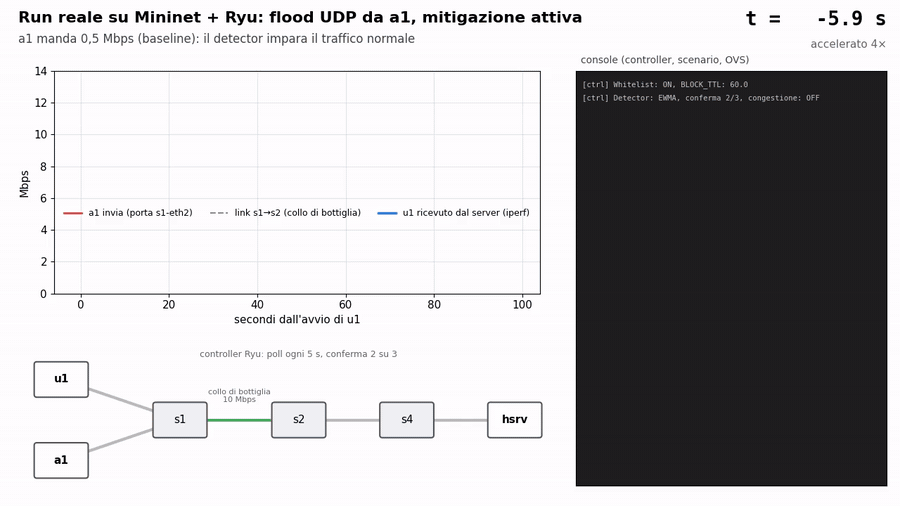
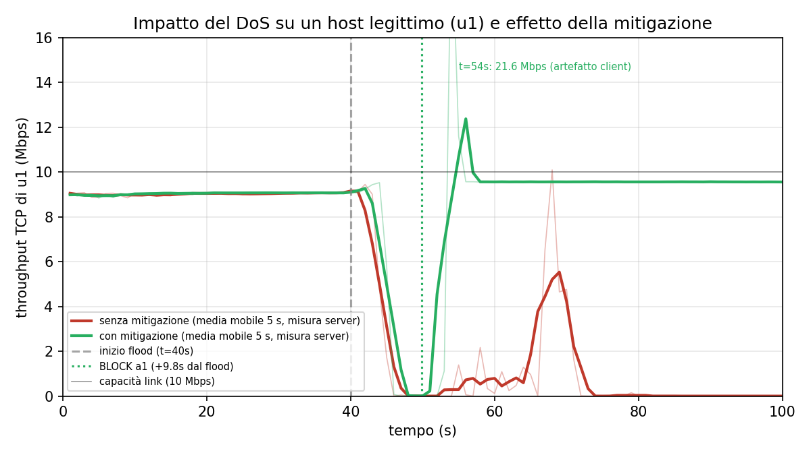
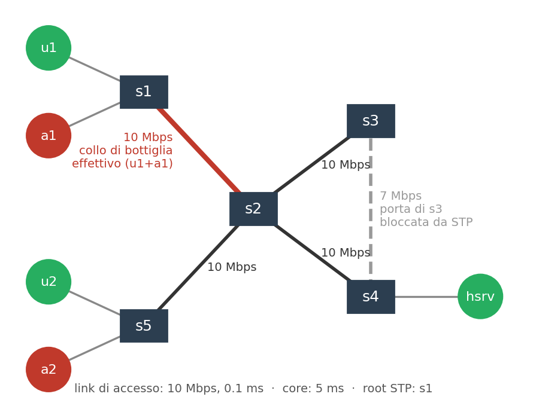

# SDN DoS Detection & Mitigation

Project work di **Network and Cloud Infrastructures** (A.A. 2025/26, traccia *Security*).
Un controller **Ryu** (OpenFlow 1.3) su una rete Mininet **monitora** il traffico, **rileva** i DoS
e li **mitiga** bloccando solo l'attaccante, per MAC sorgente, senza penalizzare gli utenti
legittimi. Parte dal baseline dell'anno precedente e ne corregge sei difetti: blocco per porta,
logica tutta nel controller, codice monolitico, soglia statica, solo DoS a rate costante,
topologia banale.

**Autori:** Massimo Marrone (M63006784), Carmine Bellotti (M63001742).
La relazione è in [`Marrone_Bellotti.pdf`](Marrone_Bellotti.pdf).

## Demo

[](docs/media/demo_mit.mp4)

Un run reale dello scenario `mit` (whitelist attiva: agisce solo sul blocco, e qui non serve,
perché `u1` non viene mai segnalato), montato dai log registrati durante il run: throughput misurato
sulle porte degli switch e da iperf, righe del controller e regole OVS, ognuno all'istante in cui è
avvenuto. `a1` manda 0,5 Mbps per 40 s, poi un flood UDP a 25 Mbps; il controller lo rileva a
+5,7 s e lo blocca a +10,7 s, e `u1` torna da 0 a 9,6 Mbps. Video completo:
[`docs/media/demo_mit.mp4`](docs/media/demo_mit.mp4).

## Risultati in breve

| Scenario | Esito |
|---|---|
| Flood UDP a 25 Mbps da `a1` | bloccato in ~10 s (polling 5 s + conferma 2/3); `u1` torna da 2,3 a 9,6 Mbps |
| Due attaccanti su switch diversi, senza whitelist | entrambi bloccati in 8 run su 8, nessun host legittimo bloccato |
| Flood "a freddo", al massimo da t = 0 | il baseline non lo vede mai; con i tetti assoluti bloccato a ~12 s |
| SYN flood verso il server, senza whitelist | attaccante bloccato a ~10 s, il server che risponde mai bloccato |



Throughput TCP di `u1` misurato dal server. Il flood parte a t = 40 s: senza mitigazione `u1` resta
quasi a zero (2,3 Mbps di media tra +20 e +60 s), con la mitigazione `a1` è bloccato a +9,8 s e
`u1` torna a 9,6 Mbps.

## Topologia



Cinque switch con un ciclo `s2–s3–s4–s2`, link da 10 Mbps (`s3–s4` da 7 Mbps). Dopo la convergenza
(~35 s) STP spegne `s3–s4` e il traffico verso `hsrv` passa per `s1–s2–s4`: il collo di bottiglia è
l'uplink `s1–s2`, condiviso dall'utente `u1` e dall'attaccante `a1`; `a2` è su un altro switch.
OVS inoltra al controller al massimo 200 packet-in/s per switch.

## Come funziona

```
Monitor ──► Detector ──► Confirmer ──► Mitigator ──► regola di drop su OVS (per MAC, TTL 60 s)
flow/port     EWMA + tetti     2 intervalli         rispetta la
stats / 5 s   (oppure ML)      su 3                 whitelist
```

- **Monitor** (`modules/monitor.py`, `features.py`): ogni 5 s legge le statistiche di OVS e le
  aggrega per sorgente, compreso il traffico che la sorgente *riceve*.
- **Detector** (`modules/detector.py`): soglia adattiva EWMA su byte/s e pacchetti/s per sorgente,
  più due tetti assoluti per il flood a freddo. Chi riceve risposte (un TCP legittimo) è esente
  dal tetto sui byte/s; chi riceve più di quanto manda (il server sotto attacco) non viene mai
  segnalato. In alternativa c'è un **MLDetector** (Random Forest su un dataset generato da noi).
- **Mitigator / Blocklist** (`modules/mitigator.py`, `blocklist.py`): blocklist condivisa, con il
  campo `source` per alimentarla anche dall'esterno.

## Avvio

Mininet richiede Linux. Il modo più semplice è Docker (su Windows: Docker Desktop con WSL2).

**1. Shell nel container.** La prima volta lo script costruisce l'immagine (`debian:11`, Python 3.9,
Mininet, OVS, Ryu, iperf, hping3), poi apre una shell già nella cartella del progetto (`/work`):

```bash
./run.sh            # Linux / macOS / Git Bash
.\run.ps1           # Windows PowerShell; -Rebuild ricostruisce l'immagine
```

**2. Demo.** `a1` inonda il server e il controller lo blocca (circa 2,5 minuti):

```bash
bash experiments/run_all.sh mit
```

**3. Risultato.** Quando `a1` è stato rilevato e bloccato, in secondi dall'inizio del flood:

```bash
python3 experiments/detection_time.py experiments/ev_mit.csv experiments/u1_tcp_mit.log.flood_start
```

```
host   mac                detect [s]   block [s]    esito
a1     00:00:00:00:00:f1  4.7          9.7          vero positivo
a2     00:00:00:00:00:f2  -            -            non rilevato
```

`a2` risulta "non rilevato" perché in `mit` non attacca.

### Altri esperimenti

Ogni esperimento si lancia con `bash experiments/run_all.sh <nome>`: lo script avvia il controller
con le opzioni giuste, esegue lo scenario e ripulisce. Log ed eventi finiscono in `experiments/`
(`ctrl_<nome>.log`, `ev_<nome>.csv`, `u1_tcp_<nome>.log`).

| Nome | Cosa fa |
|---|---|
| `topo` | raggiungibilità e percorso scelto da STP |
| `nomit` / `mit` | flood senza / con mitigazione |
| `nowl` | con mitigazione ma senza whitelist (falsi positivi) |
| `both` | `a1` e `a2` insieme, senza whitelist |
| `cold` | flood a freddo con tre detector (EWMA del baseline, ML, EWMA + tetti) |
| `syn` | SYN flood verso un servizio che risponde |
| `ml-data` / `ml-demo` | genera il dataset e addestra (~55 min) / demo del MLDetector |
| `analyze` | tempi di rilevamento di tutti i run |
| `all` | tutto, in ordine (~1 h 30 min) |

Per la demo dal vivo, `bash experiments/demo_screens.sh` (circa 13 minuti) ripete la scena della
sezione 3 della tesina in cinque configurazioni (senza mitigazione, con e senza whitelist, ML con
pacchetti piccoli e grandi) e per ognuna stampa un riepilogo: tempi di `DETECT` e `BLOCK`,
throughput di `u1`, ping di `a1`.

### Avvio a mano

Prima il controller, poi la rete, in due terminali (nel container il secondo si apre con
`docker exec -it ncis bash`). Le opzioni del controller si passano come variabili d'ambiente:

```bash
WHITELIST=0 PYTHONPATH=. ryu-manager controller.py              # terminale 1: controller
python3 experiments/scenario.py experiments/u1_tcp_prova.log    # terminale 2: rete e traffico
```

`scenario.py` accetta `--both` (attacca anche `a2`), `--cold` (flood da t = 0) e `--syn` /
`--synbig` (SYN flood). Opzioni del controller (`run_all.sh` le imposta da solo):

| Variabile | Default | Effetto |
|---|---|---|
| `DETECTOR` | `ewma` | `ewma-nohard` (EWMA del baseline), `ml`, `ensemble` (ML oppure EWMA) |
| `CONFIRM` | `2/3` | blocca dopo `k` intervalli "attacco" sugli ultimi `n` |
| `BLOCK_TTL` | `60` | durata del blocco in secondi; `0` = permanente |
| `WHITELIST` | `1` | `0` toglie la whitelist di `u1`, `u2`, `hsrv` |
| `MITIGATE` | `1` | `0` rileva e registra senza bloccare |
| `ML_THRESHOLD` | `0.5` | probabilità minima di attacco per il ML |
| `EVENT_LOG`, `FEATURE_LOG` | — | file degli eventi `DETECT`/`BLOCK` e delle feature per poll |

## Machine Learning

Il dataset è generato con `experiments/gen_dataset.sh`: episodi da 60 s con traffico benigno vario
e quattro famiglie di attacco hping3 (UDP, SYN, ICMP, low-rate), 2098 righe in tutto. I dataset
pubblici (CIC-IDS, InSDN) usano feature che il controller non può leggere dalle statistiche di OVS.
Per riaddestrare: `python3 ml/merge_datasets.py && python3 ml/train.py --holdout syn`.
La valutazione usa la cross-validation per episodio e tiene fuori dal training SYN e low-rate;
i risultati sono in `ml/results.md`.

## Struttura

```
controller.py      RyuApp: switch L2 con STP + monitoring, detection, mitigazione
topology.py        topologia Mininet (--test verifica raggiungibilità e percorso STP)
modules/           monitor, features, detector, mitigator, blocklist
ml/                estrazione feature, training, dataset, modello, risultati
experiments/       scenari, run_all.sh, analisi, log e figure dei run
docker/            Dockerfile ed entrypoint (avvia OVS)
Marrone_Bellotti.pdf  la tesina
docs/              sorgente LaTeX della tesina e video della demo
```
